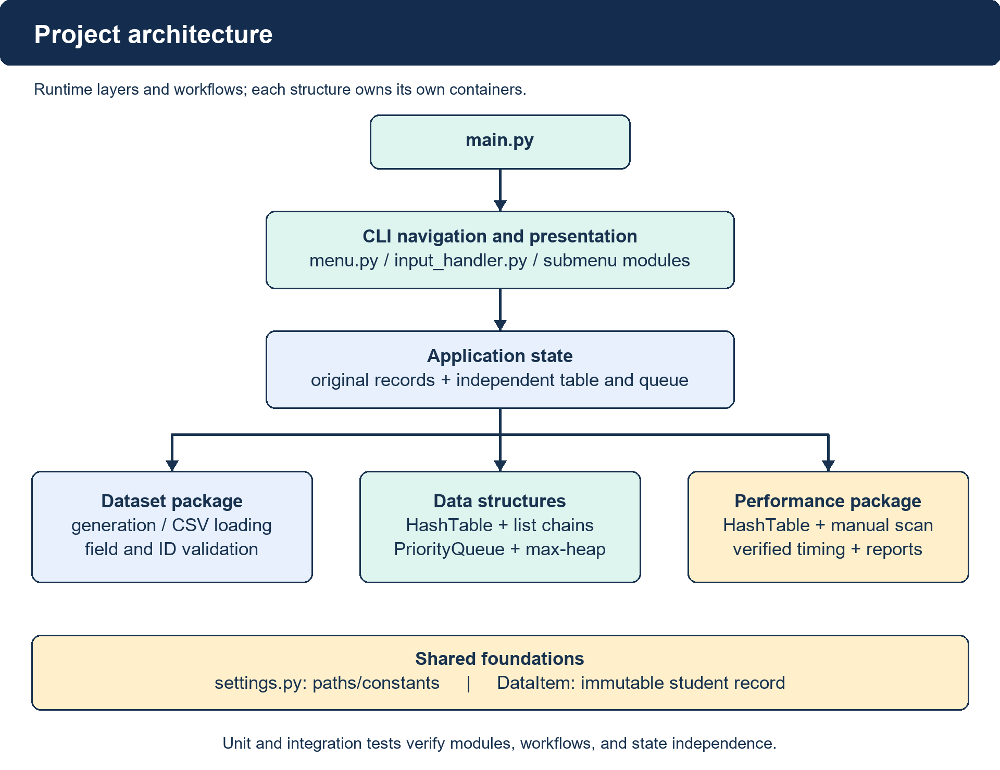
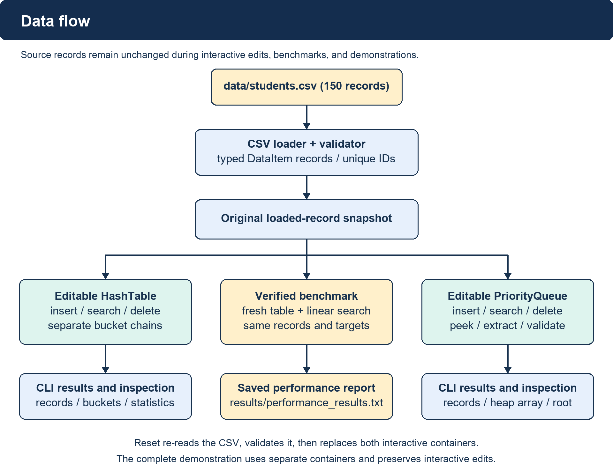

# Hash Tables and Binary Max-Heaps: Design, Verification, and Performance

Colorado State University Global

CSC506: Design and Analysis of Algorithms

October 18, 2026

## Project Design and Architecture

HeapHash Nexus implements a custom hash table and a binary max-heap priority queue over the same 150 student records. Each immutable record contains a student ID, name, program, and integer priority. The supplied CSV uses IDs 1001–1150; validation permits priorities 1–100. The goal is correct keyed retrieval and priority scheduling, followed by a measured comparison with manual linear search.

Figure 1

Project Architecture

Note. The CLI coordinates reusable modules. Algorithms remain outside menus.

## Dataset and Data Flow

The generator uses seed 42 for reproducible synthetic student data. CSV loading checks schema, field types, duplicate IDs, count, and priority bounds before exposing records. Application state retains an original snapshot and creates independent hash and heap containers; immutable records can safely be shared. CLI edits affect those containers, while reset reloads the CSV atomically. Demonstrations use isolated containers, and benchmarks verify agreement before measuring.

Figure 2

Dataset, Operations, and Results

Note. Benchmark output is separate from the source dataset. Reset restores original records.

## Hash Function Selection

The hash table maps an integer student ID to a bucket using h(k) = k mod m. Its normal configuration sets m = 211, so each result is an index from 0 through 210. For example, 1001 mod 211 = 157. The helper rejects non-integer keys, including Boolean values, and rejects invalid table sizes. Insertion, search, and deletion all call the same helper, ensuring that a key always selects the same chain.

The table owns 211 distinct Python lists rather than using a dictionary as its key-value storage. Each list holds explicit (key, value) pairs. The prime size leaves room beyond the 150-record dataset and gives a load factor of α = n/m = 150/211 ≈ 0.7109. A prime modulus alone cannot guarantee an even distribution: IDs separated by 211 still collide. Because these particular 150 IDs are consecutive and span less than 211, their residues are distinct; the normal dataset therefore has no occupied chain longer than one.

Chaining analysis depends on both bucket distribution and load, rather than the word “hash” alone. Under a suitable distribution, expected lookup work is O(1 + α); if every key lands in one bucket, lookup becomes O(n) (Morin, n.d.-b). This project uses a fixed modulus and does not resize or randomize its hash function. Its fast normal-dataset searches should therefore be interpreted with the actual key pattern in mind.

This simple arithmetic function supports reproducibility, easy auditing, and deliberate collision examples. Statistics expose item count, load factor, occupied buckets, and chain lengths so that distribution can be inspected rather than assumed. The separate size-10 collision demonstration tests behavior that the normal size-211 dataset does not exercise.

## Collision Resolution

Separate chaining keeps records with equal hash indices together in one bucket while preserving their distinct keys. An operation computes the index and scans only that list. Insertion replaces a pair when its key already exists; otherwise it appends a new pair and increments item_count. Updating a duplicate does not increase the count. Search compares keys and returns the stored value, or None when no match exists.

Deletion removes only the matching pair and decrements item_count once. It returns True for a removal and False for a missing key, preserving the count after unsuccessful deletion. Empty buckets are valid lists. Public bucket snapshots are immutable tuples, preventing callers from bypassing the methods and corrupting the count. The implementation does not require tombstones because deletion does not disrupt a probe sequence.

The deliberate collision case chooses m = 10. IDs 1001, 1011, and 1021 all yield index 1, producing a three-record chain. Tests find every record, delete the middle key 1011, then find 1001 and 1021 again. Additional tests exercise duplicate updates, missing keys, collision-heavy operations, and count consistency. These checks establish that a shared index does not imply record replacement or accidental deletion of neighboring records.

Chaining trades additional list storage and comparisons for straightforward insertion and deletion. An overloaded or poorly distributed fixed table can develop long chains; increasing capacity or rehashing would be future extensions. The current educational implementation instead exposes that limitation directly. Bucket storage is O(m + n), and an operation can require O(n) work in the worst case, including movement within a Python list after deletion. Correctness is independent of whether collisions are rare or frequent.

## Perfect and Non-Perfect Hashing

A perfect hash function maps a specified key set to distinct indices without collisions (Black, 2019). Minimal perfect hashing additionally uses exactly as many output positions as keys. For the fixed keys 1001–1150, h(k) = k − 1001 is a minimal perfect mapping into 150 positions. This construction relies on the known, contiguous set; it is not a general solution for arbitrary student IDs.

The implemented modulo-211 function is also collision-free on the supplied finite set, so it is perfect relative to that set, although it is not minimal. The distinction matters: a collision-free observation does not provide a guarantee for future keys. IDs 1001 and 1212 both map to index 157. Supporting arbitrary integer IDs requires the implemented chaining behavior even though the original CSV does not trigger it.

A non-perfect mapping allows collisions and needs a resolution strategy. Separate chaining meets that requirement here without specializing the API to a frozen roster. A static perfect mapping could reduce comparisons for a known collection, but changing the set may require reconstruction or additional handling. The project prioritizes transparent operations, configurable capacity, and verified collision behavior over construction of a specialized perfect-hashing scheme. Neither the benchmark nor the code claims collision-free behavior for all possible inputs.

## Binary Max-Heap Priority Queue

The priority queue stores a complete binary tree in a Python list, with the maximum-priority record at index 0. For index i, the parent is (i − 1) // 2, and children are 2i + 1 and 2i + 2. Array-based binary heaps use these relationships to avoid explicit node pointers (Morin, n.d.-a). This project implements a max-heap by requiring each parent priority to be at least each child priority; it does not use heapq.

Insertion rejects a duplicate student ID, appends the new record, and swaps it upward while its priority exceeds its parent’s. Peek returns the root without mutation. Extract-max replaces the removed root with the final record, then repeatedly swaps with the higher-priority child. Search scans IDs. Arbitrary deletion first locates the ID and moves the final record into the gap, then chooses upward repair if it exceeds its new parent; otherwise it repairs downward.

Heap repair is O(log n), but public insertion is O(n) because duplicate-ID checking scans the heap. Search and arbitrary deletion are also O(n); extract-max is O(log n), peek is O(1), and validation is O(n). Storage is O(n). These bounds describe the actual implementation, including validation work, rather than assigning an idealized insertion bound to the complete public method.

Equal priorities satisfy the invariant and need not retain insertion order. Empty peek and extraction return None; missing deletion returns False. Immutable snapshots prevent external list mutation. Tests validate the heap after insertion, deletion, and extraction, cover both repair directions, and confirm that repeated extraction yields nonincreasing priorities across all 150 records. Scheduling changes remain independent of the hash table.

## Testing and User Interface

The final automated suite contains 312 passing tests: 211 unit tests and 101 integration tests. Unit coverage includes dataset generation and validation (74), hash-table behavior (49), priority-queue behavior (71), and reusable CLI input validation (17). Integration coverage includes shared-dataset operations (15), performance correctness and result reporting (58), and CLI workflows (28). No timing threshold is required for a test to pass.

Integration tests load all 150 records into both structures, compare searches with expected records, delete representative IDs, verify counts, and confirm independent state. Collision tests use a deliberately small table. Heap tests cover ties, empty cases, missing keys, and arbitrary deletion. Performance tests check all-record search agreement, reject mismatched tables, and use synthetic clocks only to verify timing arithmetic and execution protocol; the reported measurements come from a separate real run.

The CLI exposes Hash Table, Priority Queue, Performance, and Dataset menus, a complete demonstration, reset, and exit. Reusable prompts reject invalid integers and out-of-range choices. Menus delegate to the core methods instead of implementing algorithms. Reset builds replacement state before assignment, so a failed reload preserves existing state. EOF and keyboard interruption exit gracefully. The noninteractive command python main.py --demo provides a reproducible end-to-end check.

The recorded final demonstration passed dataset validation, ordinary hash operations, deliberate collisions and deletion, queue operations, peek, extract-max, heap validation, independent state, benchmark agreement, and result saving. Final regression output and a requirement-to-evidence matrix accompany the report. These checks establish functional behavior for the tested inputs; they do not constitute a proof that every possible input or environment has been exhaustively tested.

## Benchmark Method

The comparison uses the original ordered 150-record dataset and a normal 211-bucket hash table. The baseline manually scans records until it finds the student ID or reaches the end. Required targets are 1001, 1025, 1075, 1125, 1150, and missing ID 9999. These correspond to positions 1, 25, 75, 125, and 150, plus a full unsuccessful scan. Hash and linear search must return matching records before measurement begins.

For each target and algorithm, the runner performs 100 warm-up searches, followed by 10,000 measured searches. Thus each algorithm executes 60,000 measured searches overall. Setup, agreement checks, warm-up, printing, and file writing are outside timed regions. The first measured algorithm alternates between targets to reduce a fixed ordering bias. Each measured block includes the loop and public search calls, so it reflects their combined overhead.

Elapsed intervals use time.perf_counter(), a high-resolution elapsed-time counter intended for short-duration measurements (Python Software Foundation, n.d.). The saved final run identifies Python 3.14.4 and Windows-11-10.0.26300-SP0. Average time is total elapsed seconds divided by repetitions, converted to microseconds. The linear/hash ratio divides the linear total by the hash total; values above one indicate lower hash-search time.

The aggregate ratio divides summed linear time by summed hash time, rather than averaging individual ratios. A zero hash total would be reported as unavailable. Results are stored in results/performance_results.txt, and the report builder records that file’s SHA-256 digest so the paper can be checked against its source. The single-machine experiment measures one block per method and target; it does not estimate confidence intervals or performance at larger dataset sizes.

## Observed Performance

Table 1 presents the actual saved final benchmark. All five present IDs were found by both methods, and both returned None for 9999. Time values are arithmetic averages per search, not single-call timer readings.

Table 1

Final Hash-Table and Linear-Search Measurements

| Student ID | Scenario | Hash (μs) | Linear (μs) | Linear/hash |
|---|---|---:|---:|---:|
| 1001 | Beginning | 0.150960 | 0.066220 | 0.439× |
| 1025 | Early | 0.147420 | 0.486260 | 3.298× |
| 1075 | Middle | 0.147240 | 1.289790 | 8.760× |
| 1125 | Late | 0.154540 | 2.240490 | 14.498× |
| 1150 | End | 0.147440 | 2.518750 | 17.083× |
| 9999 | Missing | 0.129880 | 2.384330 | 18.358× |

Note. Each row uses 10,000 measured searches per algorithm after 100 warm-ups. Ratios above one favor hash search; a ratio below one favors linear search. Values retain the saved report’s rounding.

Across all 60,000 searches per method, hash search took 0.008774800 s and linear search took 0.089858400 s. Overall averages were 0.146247 μs and 1.497640 μs, respectively, yielding a 10.241× aggregate linear/hash ratio. The first-record linear search was faster, whereas hash search was faster for the remaining targets in this run.

Later and missing linear searches examine more records, while normal-table hash searches inspect at most one stored key. The results are consistent with that difference, but the data are small, ordered, synthetic, and collision-free under modulus 211. Interpreter overhead, scheduling, and machine state affect submicrosecond averages. These measurements support this dataset comparison and do not establish a universal speedup or characterize collision-heavy performance.

## Conclusion

The completed project demonstrates two independently useful structures over one validated dataset. The hash table provides keyed updates and retrieval with explicit collision chains. The max-heap maintains a highest-priority root while supporting insertion, lookup, deletion, peek, and extraction. Clear module boundaries keep the CLI focused on input and presentation, and immutable records support safe sharing between independent containers.

All 312 automated tests and the final complete demonstration passed. The real benchmark recorded a 10.241× aggregate linear/hash time ratio across the specified six targets, while showing that a first-element linear lookup can outperform hashing. The conclusion therefore depends on workload and data distribution rather than claiming an unconditional advantage. The collision demonstration and heap-validation tests complement the normal-dataset benchmark by checking structural cases that timings alone cannot establish.

Future work could add hash-table resizing, repeated independent benchmark blocks with uncertainty estimates, larger and less uniform datasets, and an ID index for faster priority-queue lookup. Such extensions would change the current design and should be measured and tested separately. The submitted source, documented commands, diagrams, saved measurements, regression evidence, and traceability matrix allow the implemented behavior to be reviewed and reproduced.

## References

Black, P. E. (2019, February 12). Perfect hashing. In Dictionary of Algorithms and Data Structures. National Institute of Standards and Technology. https://xlinux.nist.gov/dads/HTML/perfecthash.html

Morin, P. (n.d.-a). BinaryHeap: An implicit binary tree. In Open data structures (in Java) (Section 10.1). https://opendatastructures.org/ods-java/10_1_BinaryHeap_Implicit_Bi.html

Morin, P. (n.d.-b). ChainedHashTable: Hashing with chaining. In Open data structures (in Java) (Section 5.1). https://opendatastructures.org/ods-java/5_1_ChainedHashTable_Hashin.html

Python Software Foundation. (n.d.). Time: Time access and conversions. In Python 3.14 documentation. https://docs.python.org/3.14/library/time.html#time.perf_counter
